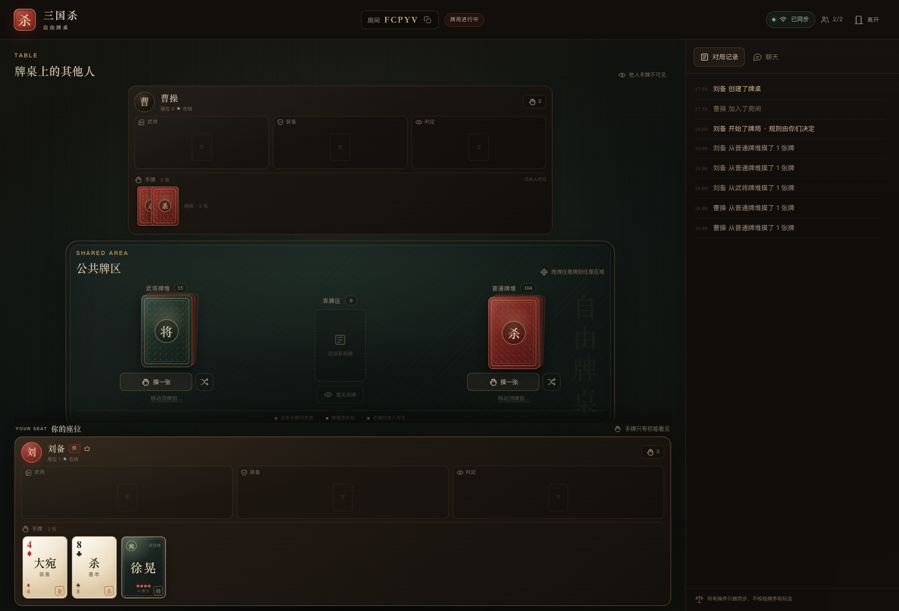
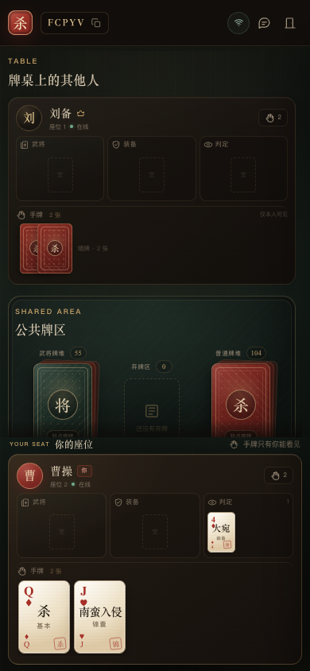
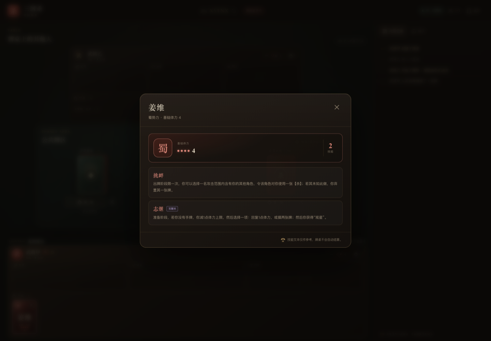

# 三国杀 · 自由牌桌

给凑不到线下局的固定牌友用的一张线上牌桌。

服务器只负责把每个人的操作同步到所有人；出牌、判定、结算、胜负全部由你们自己说了算。没有规则引擎，也没有“这张牌不能放在这里”的拦截。

## 在线试玩

当前测试部署：**<http://159.75.6.38/>**

> 无域名 HTTP 地址。房间保存在服务器内存中，服务重启后会清空。



## 已实现

- 创建房间、5 位房间号、邀请链接、1–8 人入座
- 任意玩家都可以开始牌局，不要求满员
- 武将牌堆 / 普通牌堆，各自洗乱、倒扣
- 抽牌区、公共弃牌区，以及每位玩家的手牌区、装备区、判定区、武将区
- 任意可见牌 → 任意区域：桌面拖拽、手机长按拖拽，或点击多选后使用“移动至…”
- 牌堆顶 → 任意区域；牌堆面轻点即可摸一张
- 点击牌堆可摸牌，也可以把牌堆拖到任意区域，直接发出牌堆顶的牌
- 手牌只有本人可见；对手只看到手牌数量
- 实时聊天、完整操作记录
- 断线自动重连、刷新页面恢复座位
- 离开牌桌时，自己区域内的牌进入弃牌区
- 桌面端与手机端自适应



## 快速开始

需要 Node.js 20.19 或更高版本。

```bash
npm install
npm start
```

`npm start` 会先自动构建前端，然后启动服务，默认地址：

```text
http://localhost:3000
```

服务启动时也会打印局域网地址，例如：

```text
局域网访问 http://192.168.1.8:3000
```

把局域网地址发给同一 Wi-Fi 下的朋友即可。若打不开，检查系统防火墙是否放行了该端口。

### 开发模式

```bash
npm run dev
```

- 前端：<http://localhost:5173>
- 同步服务器：<http://localhost:3000>
- Vite 已代理 `/api` 和 `/ws`

### 自定义端口

```bash
PORT=8080 HOST=0.0.0.0 npm start
```

### Docker 部署

项目自带 `Dockerfile` 和 `docker-compose.yml`：

```bash
docker compose up -d --build
```

默认映射到宿主机 `3000` 端口。可以通过环境变量改端口：

```bash
PORT=8080 docker compose up -d --build
```

如果要对公网提供长期服务，建议在前面加一层 Caddy / Nginx 反向代理并启用 HTTPS。WebSocket 使用同一域名下的 `/ws`，反向代理需要允许 Upgrade 头。

## 怎么玩

1. 一位朋友创建牌桌，把房间号或邀请链接发给其他人。
2. 其他人打开链接，输入称呼入座。
3. 任意玩家点“开始牌局”。一个人也可以先开桌试牌。
4. 洗牌、摸牌、搬牌。规则靠语音、聊天和你们的默契。

### 搬牌

- **桌面拖拽**：把任意可见的牌拖到任意区域。牌堆也可以拖，效果是移动牌堆顶的一张。
- **手机拖拽**：长按卡牌约 0.3 秒，牌会浮起，然后拖到目标区域松手。拖动时目标区域会高亮并显示“放到这里”。
- **点击**：点一张牌选中，可以继续点其他牌多选；底部会出现“移动至…”按钮。手机上轻点不会触发拖拽。
- **弃牌堆**：点“查看弃牌堆”，可以选中弃牌堆里的任意牌，关闭弹窗后统一移动。
- **目标区域**：公共牌堆顶、弃牌区、任何玩家的手牌区 / 装备区 / 判定区 / 武将区。

### 武将详情与体力



- 武将卡面上显示势力、名字、基础体力和技能名。
- 点武将卡右上角的「技」按钮，可以查看每项技能的完整描述与技能类型。
- 每位玩家名字旁边有体力控制器：`−` / `+` 调整当前体力，上限读取武将区第一张武将卡的基础体力。
- 体力调整会实时同步给所有人，并写入对局记录；牌桌不会自动判定濒死或胜负。

### 可见性

| 区域 | 可见性 |
| --- | --- |
| 手牌区 | 只有本人可见，其他人只看到数量 |
| 装备区 | 公开 |
| 判定区 | 公开 |
| 武将区 | 公开 |
| 牌堆 | 只有剩余数量公开，牌面未知 |
| 弃牌区 | 公开 |

“武将区”是为了方便摆放武将牌额外提供的展示区域。因为没有规则限制，武将牌也可以被放进手牌区、装备区、判定区或任何玩家区域。

当前武将库为标准包 + 风、林、火、山四个扩展包，共 57 名非神武将；不包含神将。技能文本采用经典版描述，仅作参考。

### 刷新与断线

座位凭证保存在浏览器 localStorage。断网后会自动重连；刷新页面会回到原座位和原牌局。房间只存在服务器内存中，**服务器进程重启后所有房间会丢失**。

## 服务器到底校验什么

它不校验玩法，但会做几项维持同步和隐私所必需的结构校验：

- 牌 ID 必须真实存在，目标区域必须存在
- 不能通过接口直接搬运其他玩家未公开的手牌，或猜 ID 抽取牌堆深处的牌
- 一次最多移动 100 张牌
- 简单频率限制，避免误触或刷屏
- 手牌和牌堆内容在发送给其他客户端前会被过滤

超出这些范围的操作，服务器不会判断“允不允许”，只会如实同步。

## 技术结构

```text
.
├── server/
│   ├── index.ts       Express + WebSocket 入口
│   ├── rooms.ts       房间状态、动作处理、按玩家过滤视图
│   └── cards.ts       牌库定义与洗牌
├── src/
│   ├── App.tsx
│   ├── shared/types.ts 客户端/服务端共用协议类型
│   ├── client/         房间、牌桌、拖拽、聊天等前端实现
│   └── styles.css      全部视觉样式
├── docs/               预览截图
└── index.html
```

- 前端：React 19 + TypeScript + Vite
- 服务端：Express + `ws`
- 每次操作后，服务端为每个在线玩家生成一份**按可见性裁剪过的完整快照**并推送。数据量很小，逻辑也更简单。
- 房间、牌堆和聊天记录都在内存中；所有房间玩家都断线 2 小时后房间会被清理。

主要协议类型在 [`src/shared/types.ts`](src/shared/types.ts)，服务端动作处理在 [`server/rooms.ts`](server/rooms.ts)。

## 自定义牌库

牌库定义在 [`server/cards.ts`](server/cards.ts)：

- `NORMAL_BLUEPRINTS`：普通牌名称、类别和数量
- `GENERAL_BLUEPRINTS`：武将名称、势力和体力
- `createCards()`：生成牌对象并打乱两个牌堆

改完重启服务即可。花色和点数目前由生成器自动分配；如果要精确控制每张牌的花色点数，可以扩展 `NORMAL_BLUEPRINTS` 的数据结构。

## 已知限制

- 没有账号系统，座位凭证只在本浏览器中保存
- 房间数据不持久化，服务重启即丢失
- 没有自定义卡牌编辑器
- 没有规则/回合/胜负判定——这是设计目标，不是遗漏
- 移动端牌桌中部可以上下滚动；自己的手牌固定在底部常驻

## 后续可以做什么

- 自定义卡牌包和卡面图片
- 房间持久化（SQLite / Redis + 事件日志）
- 观战席、房主管理、座位交换
- 出牌历史回放 / 导出
- 操作音效与更细的动画
- 可选的可视化规则脚本（仍然不强制）
